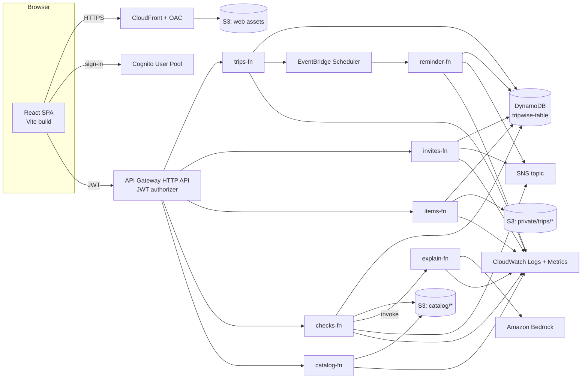
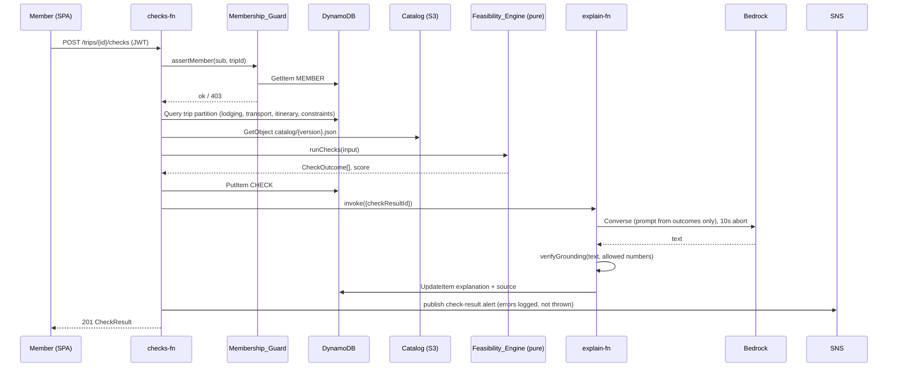

# Design Document: TripWise Trip Planner

## Overview

TripWise is a private, serverless trip planner for friend groups. The build has five parts:

- A React (Vite) single-page app. It is served from a private S3 bucket through CloudFront with origin access control (OAC), and users sign in with Amazon Cognito.
- An API Gateway HTTP API with a Cognito JWT authorizer, backed by TypeScript Lambda functions on Node.js 20. Each function has its own IAM role.
- One DynamoDB table (single-table design) for Trips, Memberships, Invitations, Plan_Items, Trip_Constraints, and Check_Results.
- S3 for web assets, private confirmation files, and the versioned Catalog JSON.
- A **pure TypeScript Feasibility_Engine package** with no AWS SDK imports, so fast-check can test it directly. Amazon Bedrock is used only to explain an already-computed Check_Result, and its output is checked against the stored numbers.

The main design rule is that **all decisions are deterministic and live in pure functions**: the feasibility checks, the score, validation, authorization decisions, number grounding, message building, schedule-time calculation, and log redaction. Lambda handlers are thin adapters that load data, call the pure functions, and persist the results. Every pure function can therefore be property-tested with in-memory fakes.

### Key Design Decisions

| Decision | Choice | Rationale |
|---|---|---|
| Data store layout | Single DynamoDB table plus one GSI | Trip data is always read by trip, and user→trips needs one GSI. On-demand billing suits a demo workload. |
| Money representation | Integer US cents everywhere (`number` holding a safe integer) | Req 14.5. No floating-point rounding. |
| Date representation | ISO `YYYY-MM-DD` strings, converted to integer "epoch days" (UTC) for arithmetic | Avoids time-zone drift in night counting. |
| Concurrency | DynamoDB `ConditionExpression` on `lastModifiedAt` (optimistic locking) | Req 23.3, with no locks or extra infrastructure. |
| Read consistency | `ConsistentRead: true` on all trip reads | Req 23.2: a write is visible on every Member's next request. |
| Validation | zod schemas in a shared package, used by both API and app | One source of truth. Errors report each field path (Req 5.6). |
| Bedrock call | Separate `explain-fn` Lambda, invoked synchronously by `checks-fn` | Only this function holds `bedrock:InvokeModel`. It has a 10 s timeout (Req 21.5). |
| Optional checks | Enabled by `ENABLED_CHECKS` env var on `checks-fn` (e.g. `Cost,Capacity,Dates,Schedule`) | Optional extensions (Req 17, 18) can ship without code forks. |
| Real-time | None. The app refetches on load or reload | Recorded Assumption 5. |

## Architecture



### Feasibility Check Flow



### Repository Layout (npm workspaces)

```
/packages/shared      # zod schemas, domain types, message builders, redaction, date utils
/packages/engine      # Feasibility_Engine: pure functions only, no AWS imports
/packages/grounding   # number extraction + grounding verifier + template explanation (pure)
/services/api         # Lambda handlers, repositories (DynamoDB/S3/SNS/Scheduler/Bedrock adapters)
/terraform            # Terraform root module (AWS provider, single `region` variable); replaces the removed CDK app in /infra
/web                  # React + Vite SPA
/scripts/seed.ts      # demo seed (Req 27)
/scripts/build-lambdas.ts  # esbuild bundles of the 7 handlers → dist/lambda/<name>.zip
/scripts/deploy.sh    # build lambdas, terraform apply, build web, s3 sync, CloudFront invalidation
/catalog/san-diego-v1.json
vitest.workspace.ts   # `npx vitest --run` runs every package's tests
```

## Components and Interfaces

### 1. Auth and Identity (Req 1, 4.4)

- The Cognito user pool requires a verified email. The SPA uses the Authorization Code + PKCE flow through `aws-amplify/auth` (Hosted UI) and keeps tokens in memory.
- Every HTTP API route except `OPTIONS` is attached to the JWT authorizer, with issuer = user pool and audience = app client. API Gateway itself returns 401 for a missing, expired, or invalid token (Req 1.3), so the Lambda never runs.
- `getCaller(event)` is the only way handlers learn who the caller is:

```typescript
export interface Caller { userId: string; email: string; emailVerified: boolean }

export function getCaller(event: APIGatewayProxyEventV2WithJWTAuthorizer): Caller {
  const c = event.requestContext.authorizer.jwt.claims;
  return {
    userId: String(c.sub),
    email: String(c.email).trim().toLowerCase(),
    emailVerified: c.email_verified === true || c.email_verified === 'true',
  };
}
```

Request bodies are parsed with zod `.strict()` schemas that do not include `userId`, `lastModifiedBy`, or `hostId`. Unknown keys are stripped before reaching business logic, so a client-supplied user ID can never reach persistence (Req 4.4).

- The SPA `apiClient` wraps `fetch` and always sets `Authorization: Bearer <idToken>` (Req 1.2). `<RequireAuth>` renders the sign-in screen until a session exists (Req 1.1).

### 2. Membership_Guard (Req 3.4, 4.1–4.3)

The access decision is a pure function. The handler wrapper runs it before any other repository access:

```typescript
export type Action = 'read' | 'write' | 'invite' | 'runCheck';
export type Decision = { allow: true } | { allow: false; status: 403 };

export function decide(membership: Membership | undefined, action: Action): Decision {
  if (!membership) return { allow: false, status: 403 };
  if (action === 'invite' && membership.role !== 'host') return { allow: false, status: 403 };
  return { allow: true };
}

// Wrapper used by every /trips/{tripId}/* route
export function withTripGuard(action: Action, handler: TripHandler): Handler {
  return async (event, ctx) => {
    const caller = getCaller(event);
    const tripId = parseTripId(event.pathParameters?.tripId);         // 400 if malformed
    const membership = await deps.memberships.get(tripId, caller.userId); // the only pre-guard read
    const d = decide(membership, action);
    if (!d.allow) return json(403, { error: 'FORBIDDEN' });          // no trip data in body
    return handler({ caller, tripId, membership: membership!, event, deps });
  };
}
```

Every route in the route table is registered through `withTripGuard`. A unit test iterates the route table (Req 28.2).

### 3. TripWise_API Routes

| Method & Path | Lambda | Guard action | Req |
|---|---|---|---|
| `POST /trips` | trips-fn | (none, creates) | 2.1–2.3, 24.2 |
| `GET /trips` | trips-fn | (lists caller's) | 2.4 |
| `GET /trips/{tripId}` | trips-fn | read | 23.1 |
| `PUT /trips/{tripId}/constraints` | trips-fn | write | 11.1–11.3, 24.2 |
| `GET /trips/{tripId}/constraints` | trips-fn | read | 11.1 |
| `POST /trips/{tripId}/invitations` | invites-fn | invite | 3.1, 3.2, 3.4 |
| `POST /invitations/{inviteId}/accept` | invites-fn | (email match) | 3.3, 3.5 |
| `GET /trips/{tripId}/sections/{section}/items` | items-fn | read | 5.4, 5.5 |
| `POST /trips/{tripId}/sections/{section}/items` | items-fn | write | 5.1, 5.5, 5.6 |
| `PUT /trips/{tripId}/sections/{section}/items/{itemId}` | items-fn | write | 5.2, 23.3 |
| `DELETE /trips/{tripId}/sections/{section}/items/{itemId}` | items-fn | write | 5.3 |
| `POST /trips/{tripId}/sections/Checklist/items/{itemId}/claim` | items-fn | write | 9.2, 9.4 |
| `POST /trips/{tripId}/items/{itemId}/confirmation-upload` | items-fn | write | 6.4 |
| `GET /trips/{tripId}/items/{itemId}/confirmation` | items-fn | read | 6.5 |
| `GET /catalog` | catalog-fn | (authenticated) | 12.x |
| `POST /trips/{tripId}/checks` | checks-fn | runCheck | 13.x, 21.x, 24.1 |
| `POST /trips/{tripId}/checks/alternatives` | checks-fn | runCheck | 20.1, 20.2 |
| `GET /trips/{tripId}/checks` | checks-fn | read | 13.6 |

The accept route does not use `withTripGuard`, because the caller is not a Member yet. It checks `caller.emailVerified && caller.email === invitation.email` (normalized lowercase) and otherwise returns 403 with no writes (Req 3.5).

### 4. Plan Item Service (Req 5–10)

```typescript
export const SECTIONS = ['Lodging','Itinerary','Transportation','Groceries',
  'Checklist','Reservations','Expenses','ScratchPad'] as const;
export type Section = typeof SECTIONS[number];

export interface ValidationContext {
  trip: { startDate: IsoDate; endDate: IsoDate };
  memberIds: ReadonlySet<string>;
}

export type FieldError = { field: string; message: string };
export type ValidationResult<T> = { ok: true; value: T } | { ok: false; errors: FieldError[] };

export function parseSection(s: string): Section | undefined;            // Req 5.5
export function validatePlanItem(section: Section, fields: unknown,
                                 ctx: ValidationContext): ValidationResult<SectionFields>; // Req 5.6
```

`validatePlanItem` runs the section's zod schema (collecting **all** issues, not only the first) and then runs the context rules. It maps each issue to `{ field: issue.path.join('.'), message }`:

| Section | Rules |
|---|---|
| Lodging | `checkOut > checkIn` (6.2); `sleeps` integer ≥ 1 (6.3); `nightlyPriceCents` integer ≥ 0; optional `listingUrl` (https URL), `address`, `confirmationNumber`, `checkInDetails.doorCode`, `catalogStayId`, `features: string[]`, `selected: boolean` |
| Itinerary | `startDate ≤ day ≤ endDate` (7.2); `startTime`/`endTime` are `HH:mm`; `endTime ≥ startTime` if present (7.3); `stopName` non-empty |
| Groceries | `quantity > 0` (8.4); `responsibleMemberId ∈ memberIds` (8.3); `purchased: boolean` |
| Checklist | `task` non-empty; `claimedBy?: string` (server-controlled, rejected if supplied in body); `done: boolean` |
| Expenses | `payerMemberId ∈ memberIds`; `amount` is a decimal string matching `^\d+(\.\d{1,2})?$` with value > 0, stored as `amountCents` (10.2) |
| Transportation, Reservations, ScratchPad (generic) | `title` non-empty; optional `notes`, `date`, `link`, `costCents` (integer ≥ 0) |

> Itinerary `day` range: Trip "days" are `startDate … endDate` inclusive (the departure day can have stops). Req 7.2 is implemented as `startDate ≤ day ≤ endDate`.

Write metadata is stamped by one pure function, so create and update behave the same way (Req 5.1, 5.2, 8.2, 9.3):

```typescript
export function stamp<T>(fields: T, callerId: string, now: () => string):
  T & { lastModifiedBy: string; lastModifiedAt: string } {
  return { ...fields, lastModifiedBy: callerId, lastModifiedAt: now() };
}
```

**Optimistic concurrency (Req 23.3).** `PUT` requires `expectedLastModifiedAt` in the body. The repository issues `UpdateItem` with `ConditionExpression: lastModifiedAt = :expected`. On `ConditionalCheckFailedException` it reads the stored item and returns `409 { error: 'STALE', current: item }`. The pure model of this rule is:

```typescript
export function applyUpdate(stored: PlanItem, expected: string, next: PlanItem):
  { ok: true; item: PlanItem } | { ok: false; status: 409; current: PlanItem };
```

**Checklist claim (Req 9.2, 9.4).** This is a pure transition with a matching DynamoDB condition, `attribute_not_exists(claimedBy) OR claimedBy = :caller`:

```typescript
export function claim(item: ChecklistItem, callerId: string):
  { ok: true; item: ChecklistItem } | { ok: false; status: 409 } {
  if (item.claimedBy && item.claimedBy !== callerId) return { ok: false, status: 409 };
  return { ok: true, item: { ...item, claimedBy: callerId } };
}
```

**Confirmation files (Req 6.4, 6.5).** `confirmationKey(tripId, itemId, fileName)` returns `private/trips/{tripId}/confirmations/{itemId}/{uuid}-{sanitized}`. The sanitizer keeps only `[A-Za-z0-9._-]`, strips `..`, and truncates to 100 chars. The upload route returns a presigned `PUT` URL (5 min, `ContentType` pinned, max 10 MB through a presigned POST policy) and records `confirmationKey` on the Lodging item. The download route returns a presigned `GET` with `expiresIn: 900` (15 min).

**Catalog prefill (Req 6.6).** The pure `lodgingFromCatalogStay(stay)` returns `{ name, address, sleeps, nightlyPriceCents, features, catalogStayId }`.

**Itinerary display (Req 7.4).** The pure `groupItinerary(items)` returns `Array<{ day, items }>` with days ascending, items within a day sorted by `startTime`, and ties broken by `itemId`.

### 5. Trip Constraints (Req 11)

```typescript
export interface TripConstraints {
  destination: string;
  startDate: IsoDate; endDate: IsoDate;
  travelerCount: number;              // integer >= 1 (11.2)
  budgetCents: number;                // integer > 0 (11.3); input accepted as dollars string, converted
  budgetType: 'total' | 'perPerson';
  requiredFeatures: string[];
  plannedActivityIds: string[];       // Catalog activity IDs
  accessibilityNeeds: string[];
  walkingDistanceLimitMeters?: number;
  travelTimeCapMinutes?: number;
}

export function totalBudgetLimitCents(c: Pick<TripConstraints,'budgetCents'|'budgetType'|'travelerCount'>): number {
  return c.budgetType === 'perPerson' ? c.budgetCents * c.travelerCount : c.budgetCents; // 11.4, 11.5
}
```

Saving constraints also writes the destination and dates to the Trip `META` item. If `startDate` changed, the handler calls the Reminder_Scheduler (Req 24.2).

### 6. Catalog (Req 12)

The Catalog lives at `s3://tripwise-data/catalog/san-diego-v{n}.json`. `CATALOG_VERSION` is an env var, and S3 bucket versioning is on. Its zod schema:

```typescript
const PriceEstimate = z.object({ cents: z.number().int().nonnegative(), estimatedAsOf: IsoDateSchema });
export const CatalogSchema = z.object({
  version: z.string().min(1),
  city: z.literal('San Diego'),
  stays: z.array(z.object({
    id: z.string(), name: z.string(), address: z.string(),
    sleeps: z.number().int().positive(),
    nightlyPrice: PriceEstimate,
    features: z.record(z.string(), z.boolean()),
  })).min(3),
  activities: z.array(z.object({
    id: z.string(), name: z.string(), pricePerPerson: PriceEstimate,
  })).min(5),
  travelTimes: z.array(z.object({ from: z.string(), to: z.string(), minutes: z.number().int().nonnegative() })),
});

export function parseCatalog(raw: unknown, version: string):
  { ok: true; catalog: Catalog } | { ok: false; version: string; errors: FieldError[] };
```

On failure, the handler logs `{ level: 'error', event: 'CATALOG_INVALID', version, errors }` and returns `500 { error: 'CATALOG_INVALID', version }` (Req 12.5). A warm Lambda caches the parsed Catalog by version.

The SPA uses `formatEstimate(price)` to produce text like `"Est. $189/night (as of 2025-01-15)"` (Req 12.4).

### 7. Feasibility_Engine (pure; Req 13–20)

```typescript
export type CheckName = 'Cost' | 'Capacity' | 'Dates' | 'Schedule' | 'Preferences';
export type Unit = 'USD_CENTS' | 'BEDS' | 'NIGHTS' | 'MINUTES' | 'FEATURES';

export interface CheckOutcome {
  check: CheckName;
  measured: number;
  limit: number;
  unit: Unit;
  passed: boolean;
  details?: { missingPairs?: Array<[string, string]>; unmetFeatures?: string[] };
}

export interface StayInput {
  stayId?: string; name: string; sleeps: number; nightlyPriceCents: number;
  features: Record<string, boolean>; checkIn: IsoDate; checkOut: IsoDate;
}

export interface EngineInput {
  stay: StayInput;
  transportCostsCents: number[];
  itinerary: Array<{ itemId: string; day: IsoDate; startTime: string; stopName: string }>;
  constraints: TripConstraints;
  catalog: Pick<Catalog, 'version' | 'activities' | 'travelTimes'>;
  enabledChecks: ReadonlyArray<CheckName>;   // always includes Cost, Capacity, Dates
}

export interface EngineOutput { outcomes: CheckOutcome[]; score: number; tripNights: number }

export function runChecks(input: EngineInput): EngineOutput;
```

The engine reads no clock, randomness, or I/O. `outcomes` are always emitted in the fixed order `Cost, Capacity, Dates, Schedule, Preferences`, filtered to the enabled set (Req 13.1, 13.2). Inputs that are unordered (transport costs, itinerary items) are normalized, by summing or by sorting on `(day, startTime, itemId)`, so input order never changes the result.

**Date helpers**

```typescript
export const toEpochDay = (d: IsoDate) => Date.UTC(+d.slice(0,4), +d.slice(5,7)-1, +d.slice(8,10)) / 86_400_000;
export const tripNights = (start: IsoDate, end: IsoDate): number[] =>       // Trip_Night list
  range(toEpochDay(start), toEpochDay(end));                                 // [start, end)
```

**Cost (Req 14).** Activity prices come from the Catalog. An unknown `plannedActivityId` raises `EngineInputError('UNKNOWN_ACTIVITY', id)`, which the handler maps to 422.

```typescript
function costCheck(i: EngineInput, nights: number): CheckOutcome {
  const lodging   = i.stay.nightlyPriceCents * nights;
  const transport = i.transportCostsCents.reduce((a, b) => a + b, 0);
  const activities = i.constraints.plannedActivityIds
    .map(id => activityPrice(i.catalog, id) * i.constraints.travelerCount)
    .reduce((a, b) => a + b, 0);
  const measured = lodging + transport + activities;
  const limit = totalBudgetLimitCents(i.constraints);
  return { check: 'Cost', measured, limit, unit: 'USD_CENTS', passed: measured <= limit };
}
```

**Capacity (Req 15).** `measured = stay.sleeps`, `limit = travelerCount`, `passed = sleeps >= travelerCount`.

**Dates (Req 16).** `nights = tripNights(start, end)`. `measured` is the count of nights `n` with `toEpochDay(checkIn) ≤ n < toEpochDay(checkOut)`. `limit = nights.length` and `passed = measured === limit`.

**Schedule (optional; Req 17).** This check runs only when `'Schedule' ∈ enabledChecks` and `travelTimeCapMinutes` is defined. For each trip day, stops are sorted by `(startTime, itemId)`. For each consecutive pair `(a, b)`: if `a === b` the leg is 0 minutes. Otherwise the engine looks up `(a,b)` and then `(b,a)` in the Travel_Time_Table. Missing pairs are collected. `measured` is the maximum daily total over legs that were found (0 if there are no legs), and `limit = travelTimeCapMinutes`. `passed = missingPairs.length === 0 && measured <= limit`, and `details.missingPairs` lists the missing pairs in sorted order (Req 17.5).

**Preferences (optional; Req 18).** `measured` is the count of `requiredFeatures` (de-duplicated) where `stay.features[f] === true`. `limit` is the count of distinct required features, and `passed = measured === limit`. `details.unmetFeatures` lists the sorted unmet features.

**Score and label (Req 19).**

```typescript
export function feasibilityScore(outcomes: CheckOutcome[]): number {
  const passed = outcomes.filter(o => o.passed).length;
  return Math.round((100 * passed) / outcomes.length);  // outcomes.length >= 3 by construction
}
export function scoreLabel(outcomes: CheckOutcome[]):
  { label: 'Feasible' | 'Not feasible'; failed: CheckOutcome[] } {
  const failed = outcomes.filter(o => !o.passed);
  return { label: failed.length === 0 ? 'Feasible' : 'Not feasible', failed };
}
```

**Selecting the current stay.** `selectCurrentLodging(items)` picks the Lodging item with `selected === true`. If none is selected, it picks the item with the latest `lastModifiedAt`, breaking ties by `itemId`. If there is no Lodging item or no constraints, the handler returns `422 { error: 'MISSING_INPUT', missing: 'Lodging' | 'TripConstraints' }` (Req 13.5).

**Alternatives (Req 20).** The pure function:

```typescript
export function buildAlternativeInput(base: EngineInput, stay: CatalogStay,
                                      latestChecks: CheckName[]): EngineInput {
  return { ...base,
    stay: { stayId: stay.id, name: stay.name, sleeps: stay.sleeps,
            nightlyPriceCents: stay.nightlyPrice.cents, features: stay.features,
            checkIn: base.stay.checkIn, checkOut: base.stay.checkOut },
    enabledChecks: latestChecks };
}
```

`latestChecks` holds the check names of the latest non-alternative Check_Result. If there is none, the handler returns 422. The handler saves the result with `kind: 'alternative'` and `evaluatedStayId`, and it performs **no writes** to Plan_Item keys. The SPA renders the outcomes of the alternative and the latest non-alternative result side by side (Req 20.3).

### 8. Explanation_Service (Req 21, 22)

`explain-fn` input is `{ tripId, checkResultId }`. The function reads the Check_Result and builds the prompt from a fixed projection:

```typescript
export interface ExplanationFacts {
  stayName: string; score: number; label: string; tripNights: number;
  outcomes: Array<Pick<CheckOutcome, 'check'|'measured'|'limit'|'unit'|'passed'|'details'>>;
}
export function toFacts(r: CheckResult): ExplanationFacts;   // whitelisting projection (21.1)
export function buildPrompt(f: ExplanationFacts): { system: string; user: string };
```

- The `system` prompt tells the model: "Use only the numbers that appear in FACTS. Do not compute differences, totals, or percentages. Do not mention prices, dates, or counts not in FACTS." (Req 21.2).
- FACTS shows cents values as dollars (e.g. `2850.00`), so the model never has to convert units.
- The function calls `BedrockRuntimeClient.send(new ConverseCommand({ modelId: process.env.MODEL_ID, ... }), { abortSignal: AbortSignal.timeout(10_000) })` with `maxTokens: 300` and `temperature: 0`.

**Grounding verifier (pure; Req 21.3, 21.4)**

```typescript
export function extractNumbers(text: string): number[] {
  return (text.match(/\d[\d,]*(?:\.\d+)?/g) ?? []).map(s => Number(s.replace(/,/g, '')));
}
export function allowedNumbers(f: ExplanationFacts): Set<number> {
  const s = new Set<number>([f.score, f.tripNights]);
  for (const o of f.outcomes) {
    s.add(o.measured); s.add(o.limit);
    if (o.unit === 'USD_CENTS') { s.add(o.measured / 100); s.add(o.limit / 100); }
  }
  return s;
}
export function verifyGrounding(text: string, f: ExplanationFacts):
  { ok: true } | { ok: false; ungrounded: number[] } {
  const allowed = allowedNumbers(f);
  const bad = extractNumbers(text).filter(n => !allowed.has(n));
  return bad.length ? { ok: false, ungrounded: bad } : { ok: true };
}
export function templateExplanation(f: ExplanationFacts): string;  // uses only allowed numbers
```

`templateExplanation` produces lines such as `"Cost: $2850.00 against a limit of $2500.00 (failed)."`. It does not include the stay name or place names, which could contain digits, so the template always passes `verifyGrounding`.

The final decision rule:

```typescript
export function chooseExplanation(bedrock: { ok: true; text: string } | { ok: false; reason: string },
                                  f: ExplanationFacts): { text: string; source: 'bedrock' | 'template' } {
  if (bedrock.ok && verifyGrounding(bedrock.text, f).ok) return { text: bedrock.text, source: 'bedrock' };
  return { text: templateExplanation(f), source: 'template' };
}
```

On fallback, the function logs `{ event: 'EXPLANATION_FALLBACK', reason }` and emits the metric `TemplateFallbackCount` (Req 21.5, 26.3). The result is stored with `UpdateItem explanation, explanationSource` (Req 21.6). If `explain-fn` itself fails, `checks-fn` stores the template explanation, so a Check_Result always has an explanation.

Number words such as "four" are not detected. The prompt reduces this risk, and the limitation is accepted for the MVP.

**Optional drafting (Req 22).** These routes are behind `ENABLE_DRAFTING`. Scratch-pad drafts are returned and never auto-saved. A trip summary receives `{ planItems, latestCheckResult }` with secret fields redacted, and it reuses `extractNumbers` against the numbers in that input. If ungrounded numbers or ungrounded availability phrases ("available", "sleeps N") are found, the route returns `422 { error: 'SUMMARY_UNGROUNDED' }`.

### 9. Notification_Service and Reminder_Scheduler (Req 3.2, 24)

- There is one SNS topic, `tripwise-notifications`. Each Member or Invitee email is subscribed once (by the invites flow), with filter policy `{ "recipient": ["<email>"] }`. Each message is published once per recipient with message attribute `recipient`.
- SNS email subscriptions must be confirmed before delivery. For the demo, seed accounts are pre-confirmed. This limitation is documented.
- Message builders are pure:

```typescript
export function inviteMessage(tripName: string, acceptUrl: string): { subject: string; body: string };
export function checkResultMessage(tripName: string, score: number, label: string): { subject: string; body: string };
export function reminderMessage(tripName: string, startDate: IsoDate): { subject: string; body: string };
```

- `safePublish(...)` wraps `PublishCommand` in try/catch. On error it logs `{ event: 'SNS_PUBLISH_FAILED', tripId, kind }` and returns normally, so the originating operation still succeeds (Req 24.4).
- **Reminder.** The pure `reminderAt(startDate)` returns `` `${startDate − 2 days}T09:00:00` `` with time zone `America/Los_Angeles`. The schedule name is `trip-reminder-{tripId}`, so there is at most one schedule per Trip. The handler calls `CreateSchedule` and falls back to `UpdateSchedule` on `ConflictException` (Req 24.2). If the time is in the past, no schedule is created. The target is `reminder-fn` with input `{ tripId }`, and `ActionAfterCompletion: DELETE` is set. `reminder-fn` loads the Trip and Members and publishes `reminderMessage` (Req 24.3).

### 10. Observability and Log Redaction (Req 25.6, 26)

- `withRequestLogging(handler)` logs one JSON line per request: `{ requestId, route, status, durationMs }` (Req 26.1). It uses `@aws-lambda-powertools/logger`.
- `redact(value)` is a pure deep copy that replaces the value of any key matching `/^(doorcode|confirmationnumber|authorization|idtoken|accesstoken|token|checkindetails)$/i` with `"[REDACTED]"`. The logger runs every log payload through it (Req 25.6). Handlers never log raw events or headers.
- Metrics use Powertools Metrics (EMF) in namespace `TripWise`: `CheckRunDurationMs`, `FailedCheckCount` (Req 26.2), and `TemplateFallbackCount` (Req 26.3).
- CloudWatch alarms: Lambda `Errors > 0` per function (5 min), API 5xx rate, and `TemplateFallbackCount > 3` per hour.

### 11. Infrastructure (Terraform, Req 25)

Infrastructure is defined in Terraform under `terraform/`, replacing the earlier AWS CDK app. The `infra/` workspace (CDK stack, constructs, and its CDK assertion tests) is removed, and `cdk bootstrap` is no longer needed. The root module uses the AWS provider configured from a single `region` variable (default `us-west-2`), so every resource lives in one Region (Req 25.1). Deployment has three steps:

1. **Lambda build**: `scripts/build-lambdas.ts` (npm script `build:lambdas`) bundles each of the 7 handlers in `services/api/src/handlers/*.ts` with esbuild (platform node, target `node20`, arm64-compatible output, AWS SDK bundled) and zips each bundle into `dist/lambda/<name>.zip`. Terraform's `aws_lambda_function` resources reference these zips with `source_code_hash`.
2. **Infrastructure**: `terraform apply` creates or updates all resources below and exposes outputs `AppUrl`, `ApiUrl`, `UserPoolId`, `UserPoolClientId`, `CognitoDomain`, `DataBucketName`, `TableName`, `ReminderFunctionArn`, and `SchedulerRoleArn`.
3. **Web and Catalog upload**: `scripts/deploy.sh` writes `web/.env.local` from the Terraform outputs, builds the web app, runs `aws s3 sync` for `web/dist` (to `WebBucket`) and `catalog/` (to `DataBucket` under `catalog/`), then creates a CloudFront invalidation. This replaces the CDK `BucketDeployment`.

The module contains:

- Cognito user pool (email sign-in, verified email required), user pool client (PKCE, Hosted UI domain).
- API Gateway HTTP API with a Cognito JWT authorizer attached to every route, and CORS limited to the CloudFront domain. The route list matches `services/api/src/routes.ts`.
- 7 Lambda functions (Node.js 20, arm64) from the zips above, each with its own log group, `aws_lambda_permission` for API Gateway (and for the scheduler on reminder-fn), the env vars `TABLE_NAME`, `CATALOG_VERSION`, `ENABLED_CHECKS`, `MODEL_ID`, `TOPIC_ARN`, a 10 s timeout on explain-fn and 20 s on checks-fn. Each function gets its own IAM role with an inline policy scoped to exact ARNs (Req 25.3):

| Function | Allowed actions (resources) |
|---|---|
| trips-fn | `dynamodb:GetItem, PutItem, UpdateItem, Query, TransactWriteItems` (table, GSI1); `scheduler:CreateSchedule, UpdateSchedule` (`schedule/default/trip-reminder-*`); `iam:PassRole` (scheduler role) |
| invites-fn | `dynamodb:GetItem, PutItem, UpdateItem, TransactWriteItems, Query` (table, GSI1); `sns:Publish, sns:Subscribe` (topic) |
| items-fn | `dynamodb:GetItem, PutItem, UpdateItem, DeleteItem, Query` (table); `s3:PutObject, GetObject` (`private/trips/*`) |
| catalog-fn | `s3:GetObject` (`catalog/*`) |
| checks-fn | `dynamodb:GetItem, PutItem, Query` (table); `s3:GetObject` (`catalog/*`); `lambda:InvokeFunction` (explain-fn); `sns:Publish` (topic) |
| explain-fn | `dynamodb:GetItem, UpdateItem` (table); `bedrock:InvokeModel` (one model ARN) |
| reminder-fn | `dynamodb:GetItem, Query` (table); `sns:Publish` (topic) |

All roles also get `logs:CreateLogStream, PutLogEvents` on their own log group. The scheduler role only gets `lambda:InvokeFunction` on reminder-fn.

- DynamoDB table (on-demand, server-side encryption with the AWS-managed key, PITR on) with `GSI1`.
- S3 `WebBucket` and `DataBucket`, both with all four public access blocks on, SSE-S3 encryption, a bucket policy denying requests where `aws:SecureTransport` is false, and versioning on `DataBucket` (Req 25.4, 25.5).
- CloudFront distribution with an origin access control on `WebBucket` (bucket policy allows only that distribution), and SPA error responses (403/404 → `/index.html`, 200).
- SNS topic (SSE with `alias/aws/sns`), the scheduler IAM role, and CloudWatch alarms.

Checks that replace the removed CDK assertion tests: `terraform fmt -check` and `terraform validate` pass; `services/api/src/routes.test.ts` compares the route table in `services/api/src/routes.ts` with the routes declared in `terraform/` so every route exists and has the authorizer; and the IAM policies in `terraform/` list exact resource ARNs (no `"*"` except where AWS requires it).

### 12. Web UI design (Req 2, 3, 5–11, 13, 19–21, 23)

The web app in `web/` uses React 18, Vite, and plain CSS. No UI or CSS libraries are added. The UI rework changes presentation only: backend APIs, the API modules in `web/src/api/*.ts`, component props used by other components, and component behavior stay the same.

**Design tokens.** `web/src/styles.css` defines CSS custom properties on `:root` and every rule uses them:

- Color: light theme with neutral surface, border, and text scales and one accent color for primary actions, links, and focus rings. Status colors are pass = green, fail = red, warning = amber, each with a soft background variant for badges and banners.
- Spacing scale (4 px base), radius scale (small, medium, large, pill), shadow scale (card, raised, overlay), and typography (system font stack, a size scale, weights, line heights).
- A visible `:focus-visible` ring on every interactive element, and a `prefers-reduced-motion: reduce` block that turns off transitions and animations.

**UI primitives in `web/src/ui/`.** Small, typed components with no data fetching:

| Primitive | Purpose |
|---|---|
| `Button`, `IconButton` | Variants primary, secondary, ghost, danger; loading and disabled states; `IconButton` requires an `aria-label` |
| `Card` | Surface with optional header, actions, and footer |
| `Badge` | Status or label pill (neutral, accent, pass, fail, warning) |
| `Avatar`, `AvatarStack` | Initials and a stable color derived from a Member's display name; the stack shows the first few and a "+N" count |
| `ProgressBar` | Value against a max, with a tone (pass, warning, fail) and an accessible label |
| `ScoreRing` | Circular Feasibility_Score (0–100) with the label in the center |
| `Dialog`, `ConfirmDialog` | Modal with `role="dialog"`, `aria-modal`, labelled title, focus trap, Escape to close, focus returned to the opener; `ConfirmDialog` asks before destructive actions |
| `Drawer` | Side panel built on the same focus and Escape handling; used for add and edit forms; full width below 600 px |
| `ToastProvider`, `useToast` | Mounted once in `main.tsx`; toasts render in an `aria-live="polite"` region (errors use `role="alert"`) and dismiss automatically |
| `Skeleton` | Loading placeholders for cards, lists, and text |
| `EmptyState` | Icon, message, and a primary action |
| `Tabs` | `role="tablist"`/`tab`/`tabpanel` with `aria-selected`, `aria-controls`, and arrow-key navigation |
| `Field`, `TextInput`, `Select`, `Checkbox` | Label, hint, and inline error wiring (`aria-invalid`, `aria-describedby`) around native inputs |

**App shell.** `main.tsx` and `router.tsx` render a top bar (logo linking to Trips home, the current user's name or email, Sign out) and breadcrumbs (Trips › Trip name › Tab) above the routed page.

**Trips home (`TripsPage.tsx`).** A responsive grid of trip cards showing destination, dates, the caller's Role (Host or Member), member avatars when available, and the latest check status badge when available. A "New trip" button opens a Dialog whose form runs `validateTripInput` before `POST /trips` (Req 2.1, 2.4). With no trips, an EmptyState offers to create one. Skeleton cards show while loading. `AcceptInvite.tsx` shows clear success (link to the trip) and error states.

**Trip page (`TripPage.tsx`).** The header shows trip name, destination, dates, a days-until-start countdown, member avatars, and an Invite button that opens a Dialog with the existing invitation form (Req 3.1). The page still fetches Plan_Items, Trip_Constraints, and the latest Check_Result on load (Req 23.1). Below the header, `Tabs` list Overview first, then Lodging, Itinerary, Groceries, Checklist, Expenses, the generic sections, Constraints, and Checks.

**Overview tab (`TripOverview.tsx`).** A dashboard of cards built from data the page already loads: the selected stay; budget used versus limit from the latest Check_Result's Cost outcome (ProgressBar); the Feasibility_Score as a ScoreRing with its label; checklist done/total; groceries purchased/total; the next itinerary stops; and quick actions (add item, run checks, invite). Each card falls back to an EmptyState-style prompt when its data is missing.

**Section screens.** Items render as cards instead of tables. "Add" and "Edit" open a Drawer form that keeps the existing validators and inline field errors. Checkboxes (checklist done, grocery purchased) toggle inline. Member display names replace Member IDs. Each section has an EmptyState. Deletes go through ConfirmDialog. Toasts confirm save and delete, and a version conflict shows a toast plus the existing stale-conflict reload prompt (Req 23.3). `lastModified` stays visible on each card (Req 5.7). Lodging shows stay cards, a catalog picker as cards with "Estimated as of <date>" labels, a Selected badge, and confirmation upload and download (Req 6.1, 12). Itinerary renders as a day-by-day timeline (Req 7.4). Groceries and Checklist keep their fields and toggles (Req 8.1, 9.1). Expenses keeps no payment controls (Req 10.3). Constraints keeps its form and validation, laid out as grouped cards (Req 11.1).

**Checks (`ChecksPanel.tsx`, `AlternativeView.tsx`).** A large Feasible / Not feasible banner with the ScoreRing (Req 19.2–19.4); one card per check with a measured-versus-limit bar and unit-aware formatting from `format.ts` (currency, people, nights, minutes), failed checks listed first; the Bedrock explanation in a highlighted box with a source Badge (Bedrock or template) (Req 21.6); history as a compact newest-first list (Req 13.6); and alternatives as side-by-side cards (Req 20.3).

**States, layout, and accessibility.** Every data view has a Skeleton loading state and a friendly error state with a Retry action. Layout is responsive down to 360 px wide (cards stack, tabs scroll horizontally, Drawer goes full width). Dialogs, tabs, and toasts carry the ARIA roles above, and all controls are reachable by keyboard with visible focus.

## Data Models

### DynamoDB Single Table: `tripwise-table`

| Entity | PK | SK | GSI1PK / GSI1SK | Attributes |
|---|---|---|---|---|
| Trip | `TRIP#{tripId}` | `META` | — | name, destination, startDate, endDate, hostId, createdAt |
| Membership | `TRIP#{tripId}` | `MEMBER#{userId}` | `USER#{userId}` / `TRIP#{tripId}` | role (`host`\|`member`), displayName, email, tripName |
| Invitation | `TRIP#{tripId}` | `INVITE#{inviteId}` | `INVITE#{inviteId}` / `INVITE` | email (lowercase), status (`pending`\|`accepted`), invitedBy, createdAt |
| Trip_Constraints | `TRIP#{tripId}` | `CONSTRAINTS` | — | TripConstraints fields, lastModifiedBy, lastModifiedAt |
| Plan_Item | `TRIP#{tripId}` | `ITEM#{section}#{itemId}` | — | section, fields (map), lastModifiedBy, lastModifiedAt, createdAt |
| Check_Result | `TRIP#{tripId}` | `CHECK#{runAt ISO}#{checkId}` | — | kind (`standard`\|`alternative`), evaluatedStay {stayId?, name}, catalogVersion, outcomes, score, label, tripNights, explanation, explanationSource |

- Trip creation is one `TransactWriteItems` call (META + host MEMBER) (Req 2.1).
- Trip list is `Query GSI1 PK = USER#{sub}`, which returns only trips where the caller is a Member (Req 2.4).
- Section list is `Query PK = TRIP#id, begins_with(SK, 'ITEM#{section}#')`, paginated until complete (Req 5.4).
- Check history is `Query begins_with(SK,'CHECK#')` with `ScanIndexForward: false`, giving newest first (Req 13.6). ISO timestamps with fixed width sort lexicographically.
- Invitation acceptance is one `TransactWriteItems` call: Put MEMBER plus Update INVITE with `status = :pending` as the condition (Req 3.3).

### Core TypeScript Types

```typescript
export type IsoDate = string; // YYYY-MM-DD, validated by IsoDateSchema

export interface Trip { tripId: string; name: string; destination: string;
  startDate: IsoDate; endDate: IsoDate; hostId: string; createdAt: string }

export interface Membership { tripId: string; userId: string; role: 'host' | 'member';
  displayName: string; email: string }

export interface PlanItem<F = Record<string, unknown>> { tripId: string; itemId: string;
  section: Section; fields: F; lastModifiedBy: string; lastModifiedAt: string; createdAt: string }

export interface CheckResult { tripId: string; checkId: string; runAt: string;
  kind: 'standard' | 'alternative'; evaluatedStay: { stayId?: string; name: string };
  catalogVersion: string; outcomes: CheckOutcome[]; score: number;
  label: 'Feasible' | 'Not feasible'; tripNights: number;
  explanation?: string; explanationSource?: 'bedrock' | 'template' }
```

### Demo Seed (Req 27)

`scripts/seed.ts` creates 4 Cognito test users and a Trip from `2025-06-12` to `2025-06-16` (4 nights). It sets constraints `travelerCount: 4, budgetCents: 250000, budgetType: 'total'` and selects the Catalog stay `sd-gaslamp-studio` (sleeps 2, $180/night). Running the check gives Capacity failed with measured 2 and limit 4. The Catalog also contains `sd-northpark-house` (sleeps 6, $450/night, so 4 × 45000 = 180000 cents plus activities ≤ 250000), which makes every Check pass when selected. An integration test runs the engine on the seed input and asserts both outcomes (Req 27.2, 27.3), and checks that `chooseExplanation` output passes `verifyGrounding` (Req 27.4).

## Error Handling

| Condition | Response | Where |
|---|---|---|
| Missing, expired, or invalid JWT | 401 (from API Gateway, Lambda not invoked) | Req 1.3 |
| Caller not a Member, or non-Host invite | 403 `{ error: 'FORBIDDEN' }`, no trip data | Req 3.4, 4.2 |
| Invitation email mismatch or unverified email | 403 `{ error: 'INVITE_EMAIL_MISMATCH' }`, no writes | Req 3.5 |
| Invalid trip dates or empty name/destination | 400 `{ error: 'VALIDATION', fields: [{field, message}] }` | Req 2.2, 2.3 |
| Unknown Section | 400 `{ error: 'UNKNOWN_SECTION', section }` | Req 5.5 |
| Section schema or context violation | 400 `{ error: 'VALIDATION', fields: [...] }`, listing all fields | Req 5.6, 6.2, 6.3, 7.2, 7.3, 8.3, 8.4, 10.2 |
| Invalid constraints | 400 `{ error: 'VALIDATION', fields }` | Req 11.2, 11.3 |
| Checklist already claimed by another Member | 409 `{ error: 'ALREADY_CLAIMED', claimedBy }` | Req 9.4 |
| Stale update | 409 `{ error: 'STALE', current: PlanItem }` | Req 23.3 |
| Missing Lodging or constraints; unknown activity; no base result for alternative | 422 `{ error: 'MISSING_INPUT' \| 'UNKNOWN_ACTIVITY' \| 'NO_BASE_RESULT', ... }` | Req 13.5, 20.1 |
| Catalog fails schema | 500 `{ error: 'CATALOG_INVALID', version }`, errors logged | Req 12.5 |
| Bedrock error, timeout, or ungrounded text | Template explanation stored, fallback metric emitted | Req 21.4, 21.5 |
| SNS publish failure | Logged; the originating operation still returns success | Req 24.4 |
| Scheduler failure | Logged with `event: 'SCHEDULE_FAILED'`; trip save still succeeds | Req 24.2 (best effort) |
| Unexpected exception | 500 `{ error: 'INTERNAL', requestId }`; stack logged after redaction | Req 26.1 |

Error bodies never include door codes, confirmation numbers, or tokens. Conditional-write failures are mapped explicitly, and all other DynamoDB errors become 500.

## Correctness Properties

*A property is a characteristic or behavior that should hold true across all valid executions of a system-essentially, a formal statement about what the system should do. Properties serve as the bridge between human-readable specifications and machine-verifiable correctness guarantees.*

Consolidation notes: the per-section validation criteria (6.2, 6.3, 7.2, 7.3, 8.3, 8.4, 10.2) are merged into one validator property with exact error-field reporting (5.6). Create and update stamping (5.1, 5.2, 8.2, 9.3) are merged. Pass/fail rules are merged with the measured/limit formulas of each check. Budget-limit criteria (11.4, 11.5, 14.2) are merged. The three SNS message criteria are merged into one property. Guard criteria 3.4, 4.2, and 4.3 are merged into one decision property, while "no store access before the guard" (4.1) stays separate.

### Property 1: Trip input validation

*For any* trip submission (name, destination, startDate, endDate), validation accepts it if and only if the name and destination are non-empty after trimming and endDate is later than startDate. When it rejects, the error list names exactly the invalid fields.

**Validates: Requirements 2.2, 2.3**

### Property 2: Created trip has its creator as Host and Member

*For any* valid trip submission and caller, after creation the in-memory store contains the Trip with `hostId = caller` and a Membership for the caller with role `host`.

**Validates: Requirements 2.1**

### Property 3: Trip list is exactly the caller's memberships

*For any* set of Trips and Memberships and any user, `listTrips(user)` returns exactly the Trips for which a Membership with that user ID exists.

**Validates: Requirements 2.4**

### Property 4: Invitation acceptance requires a matching verified email

*For any* pending invitation and any caller, acceptance succeeds (adding exactly one Membership and marking the invitation accepted) if and only if the caller's email is verified and equals the invitation email case-insensitively. Otherwise it returns 403 and the Membership set is unchanged.

**Validates: Requirements 3.3, 3.5**

### Property 5: Access decision

*For any* Membership value (absent, `member`, or `host`) and any action, `decide` allows the action if and only if a Membership exists and the action is not `invite` or the role is `host`. Every denial has status 403.

**Validates: Requirements 3.4, 4.2, 4.3**

### Property 6: No trip data access before a successful guard

*For any* guarded route and any caller who is not a Member, the handler returns 403 with no trip data in the body, and the fake repositories record no calls except the single Membership lookup.

**Validates: Requirements 4.1, 4.2**

### Property 7: Caller identity comes only from the token

*For any* request whose body or query string contains arbitrary `userId`, `lastModifiedBy`, `hostId`, or `claimedBy` values, every persisted user-ID field equals the token `sub`.

**Validates: Requirements 4.4**

### Property 8: Write stamping

*For any* valid fields, caller ID, and clock value, the item stored by create or update has the submitted field values, `lastModifiedBy = caller`, and `lastModifiedAt = clock value`.

**Validates: Requirements 5.1, 5.2, 8.2, 9.3**

### Property 9: Plan item store round trip

*For any* sequence of create and delete operations across Sections, listing a Section returns exactly the items created in that Section and not deleted, with field values equal to those stored.

**Validates: Requirements 5.3, 5.4**

### Property 10: Section name validation

*For any* string, `parseSection` accepts it if and only if it is one of the 8 valid Section names.

**Validates: Requirements 5.5**

### Property 11: Section validators accept exactly valid items and name every invalid field

*For any* Section, valid base fields, validation context, and subset of fields corrupted to violate their rule, `validatePlanItem` returns `ok` if and only if the subset is empty. Otherwise the set of reported error fields equals the corrupted subset. The rules covered are: Lodging check-out after check-in and positive integer sleeps; Itinerary day within the trip range and end time ≥ start time; Groceries positive quantity and responsible person in the member set; Expenses positive amount with at most 2 decimals.

**Validates: Requirements 5.6, 6.2, 6.3, 7.2, 7.3, 8.3, 8.4, 10.2**

### Property 12: Confirmation keys stay under the trip's private prefix

*For any* tripId, itemId, and file name (including `../`, slashes, and Unicode), `confirmationKey` returns a key that starts with `private/trips/{tripId}/confirmations/{itemId}/` and contains no `..` segment.

**Validates: Requirements 6.4**

### Property 13: Catalog prefill preserves stay data

*For any* valid Catalog stay, `lodgingFromCatalogStay` yields fields whose name, address, sleeps, and nightlyPriceCents equal the stay's values, and the result passes Lodging validation when given valid dates.

**Validates: Requirements 6.6**

### Property 14: Itinerary grouping is an ordered permutation

*For any* list of Itinerary items, `groupItinerary` returns groups with strictly ascending days. Each group contains only items for its day, sorted by start time. The flattened output is a permutation of the input.

**Validates: Requirements 7.4**

### Property 15: Checklist claim transition

*For any* Checklist item and caller, `claim` succeeds with `claimedBy = caller` if the item is unclaimed or already claimed by the caller. Otherwise it returns 409 and the item is unchanged.

**Validates: Requirements 9.2, 9.4**

### Property 16: Constraints validation and round trip

*For any* constraints input, validation accepts it if and only if travelerCount is a positive integer and budget is positive. *For any* valid constraints, saving and then reading returns an equal object.

**Validates: Requirements 11.1, 11.2, 11.3**

### Property 17: Total budget limit

*For any* valid constraints, `totalBudgetLimitCents` equals `budgetCents × travelerCount` when the type is per person and `budgetCents` when the type is total, and the Cost outcome limit equals this value.

**Validates: Requirements 11.4, 11.5, 14.2**

### Property 18: Estimated prices are labeled with their date

*For any* price estimate, `formatEstimate` output contains "Est." and the `estimatedAsOf` date.

**Validates: Requirements 12.4**

### Property 19: Invalid catalogs are rejected with their version

*For any* valid Catalog with one schema-breaking mutation (field removed, wrong type, negative price, or too few stays/activities), `parseCatalog` returns `ok: false` with the supplied version and at least one error.

**Validates: Requirements 12.5**

### Property 20: Outcome set and shape

*For any* valid engine input, `runChecks` returns outcomes whose check names are, in fixed order, Cost, Capacity, and Dates plus each enabled optional check whose preconditions hold. Every outcome has a finite measured value, a finite limit, a unit, and a boolean `passed`.

**Validates: Requirements 13.1, 13.4**

### Property 21: Engine determinism

*For any* valid engine input, running `runChecks` twice, or after permuting the transport cost list and the itinerary list, produces deeply equal output.

**Validates: Requirements 13.2**

### Property 22: History is newest first

*For any* set of saved Check_Results, the history query returns all of them ordered by `runAt` descending.

**Validates: Requirements 13.6**

### Property 23: Cost check matches the reference formula

*For any* valid engine input, the Cost measured value equals `nightlyPriceCents × tripNights + Σ transportCostsCents + Σ (activityPriceCents × travelerCount)` computed by a simple reference. The measured value and limit are safe integers, and `passed ⇔ measured ≤ limit`.

**Validates: Requirements 14.1, 14.3, 14.4, 14.5**

### Property 24: Capacity check

*For any* sleeps count and traveler count (positive integers), the Capacity outcome has `measured = sleeps`, `limit = travelerCount`, and `passed ⇔ sleeps ≥ travelerCount`.

**Validates: Requirements 15.1, 15.2, 15.3**

### Property 25: Dates check matches night enumeration

*For any* trip date range and lodging check-in/check-out range, the Dates outcome has `limit` equal to the number of Trip_Nights and `measured` equal to the number of Trip_Nights `n` with `checkIn ≤ n < checkOut`. `passed` holds if and only if every Trip_Night is covered.

**Validates: Requirements 16.1, 16.2, 16.3**

### Property 26: Schedule check matches a reference model

*For any* itinerary, Travel_Time_Table, and cap with Schedule enabled, the Schedule `measured` equals the maximum per-day sum of looked-up minutes between consecutive stops ordered by start time. `limit` equals the cap. `passed` holds if and only if no pair is missing and measured ≤ cap. Removing the table entry for any consecutive pair causes `passed = false`, with that pair listed in `missingPairs`.

**Validates: Requirements 17.1, 17.2, 17.3, 17.4, 17.5**

### Property 27: Preferences check

*For any* set of required features and stay feature map with Preferences enabled, `measured` equals the number of distinct required features that are true for the stay and `limit` equals the number of distinct required features. `passed` holds if and only if they are equal, and `unmetFeatures` equals the required features that are not true.

**Validates: Requirements 18.1, 18.2, 18.3**

### Property 28: Score and label

*For any* non-empty list of outcomes, `feasibilityScore` equals `round(100 × passed / executed)` and lies in [0, 100]. The label is "Feasible" if and only if every outcome passed. The `failed` list equals exactly the outcomes with `passed = false`.

**Validates: Requirements 19.1, 19.2, 19.3**

### Property 29: Alternatives reuse checks and leave the plan unchanged

*For any* base engine input, Catalog stay, and latest check-name list, the alternative run's check names equal the latest list. Its outcomes equal `runChecks` on the input with only the stay substituted. After the alternative handler runs on an in-memory store, every Plan_Item is deeply equal to its prior value, and the new Check_Result has `kind = 'alternative'` and `evaluatedStay.stayId = stay.id`.

**Validates: Requirements 20.1, 20.2**

### Property 30: Prompt contains only whitelisted facts

*For any* Check_Result together with a plan containing randomly generated secret strings (door codes, confirmation numbers, addresses), `buildPrompt(toFacts(result))` contains none of the secret strings. Every number in it is in `allowedNumbers`.

**Validates: Requirements 21.1**

### Property 31: Grounding verifier soundness

*For any* explanation facts, text built only from allowed numbers (in any dollar/comma formatting) passes `verifyGrounding`. Inserting any number not in `allowedNumbers` makes it fail and report that number.

**Validates: Requirements 21.3**

### Property 32: Stored explanations are always grounded

*For any* explanation facts and any Bedrock outcome (success with arbitrary text, error, or timeout), the text returned by `chooseExplanation` passes `verifyGrounding`. The source is `bedrock` if and only if the Bedrock call succeeded and its text was grounded.

**Validates: Requirements 21.4, 21.5, 27.4**

### Property 33: Optimistic concurrency

*For any* stored Plan_Item and expected `lastModifiedAt`, `applyUpdate` succeeds if and only if the expected value equals the stored value. Otherwise it returns 409 with the unchanged stored item.

**Validates: Requirements 23.3**

### Property 34: Notification messages carry required fields

*For any* trip name, accept URL, score, label, and start date, the invite message contains the trip name and accept URL. The check-result message contains the trip name, score, and label. The reminder message contains the trip name and start date.

**Validates: Requirements 3.2, 24.1, 24.3**

### Property 35: Reminder time is two days before start

*For any* valid start date, `reminderAt(startDate)` is a date exactly 2 calendar days before startDate, and the schedule name depends only on tripId, so there is one schedule per Trip.

**Validates: Requirements 24.2**

### Property 36: Log redaction

*For any* nested JSON value that contains secret values under redacted key names (any casing, any depth, inside arrays), the serialized output of `redact` contains none of those secret values and keeps every non-secret leaf unchanged.

**Validates: Requirements 25.6**

## Testing Strategy

All tests run with one non-watch command, `npx vitest --run`, configured through `vitest.workspace.ts` (Req 28.4).

### Property-based tests (fast-check)

- Each property above is implemented by **one** fast-check test with `{ numRuns: 100 }` or more. Each test carries a tag comment, e.g.
  `// Feature: tripwise-trip-planner, Property 23: Cost check matches the reference formula`.
- Shared generators in `packages/engine/test/arbitraries.ts`:
  - `arbIsoDate`, and `arbDateRange` (end after start, ≤ 30 nights).
  - `arbCents` (integers 0…10,000,000).
  - `arbConstraints`, `arbCatalog` (≥ 3 stays, ≥ 5 activities, place names that may contain digits), `arbStay`, and `arbItinerary` (days within range, `HH:mm` times, repeated stop names).
  - `arbEngineInput`, which ties these together so planned activity IDs exist in the catalog.
- Edge cases the generators must cover: zero-night overlap, lodging that starts before or ends after the trip, a single-night trip, traveler count 1, budget exactly equal to cost, empty transport and activity lists, empty required features, days with 0 or 1 stops, same-name consecutive stops, whitespace-only names, amounts like `0.001`, `1.5`, and `0`, and Unicode file names.
- Properties 1–23 and 28–36 test pure functions directly. Properties 2, 3, 6, 7, 9, 16, 22, and 29 run handlers against in-memory repository fakes that implement the same interfaces as the DynamoDB adapters.
- Engine package coverage (Req 28.1): Properties 23–28 cover the Cost, Capacity, Dates, Schedule, and Preferences checks and the Feasibility_Score.

### Unit and example tests (vitest)

- The Membership_Guard route-table test iterates every `/trips/{tripId}/*` route and asserts 403 with a non-member fake (Req 28.2).
- Grounding examples (Req 28.3) include `"$2,850.00"`, `"2850"`, `"75%"`, a template explanation, and a Bedrock text with a computed difference (`"$350 over"`, which must be rejected).
- `explain-fn` is tested with mocked Bedrock (`aws-sdk-client-mock`) for success, error, and a timeout simulated with fake timers (Req 21.5, 21.6). The mock also asserts that the prompt includes the "use only numbers" instruction (Req 21.2).
- SNS publish failure leaves a 201 response (Req 24.4). Bedrock fallback and engine runs emit metrics (Req 26.2, 26.3). One structured log line is written per request (Req 26.1).
- 422 cases cover a missing lodging, missing constraints, an unknown activity, and an alternative with no base result (Req 13.5). A presigned URL `expiresIn ≤ 900` test covers Req 6.5.
- React Testing Library tests cover: the RequireAuth gate (1.1); the apiClient header (1.2); lastModified display (5.7); the generic CRUD screens (5.8); section forms (6.1, 7.1, 8.1, 9.1, 10.1); no payment controls in Expenses (10.3); outcome table and label rendering (19.3, 19.4); the side-by-side alternative view (20.3); and fetch on load (23.1).

### Smoke and integration tests

- Infrastructure checks replace the removed CDK assertions: `terraform fmt -check` and `terraform validate` pass, and `services/api/src/routes.test.ts` asserts that every route in `routes.ts` is declared in `terraform/` with the JWT authorizer. Single region, per-function roles, exact-ARN policies, blocked public access, encryption, and the OAC origin are defined in `terraform/` and reviewed in `terraform plan` (Req 1.3, 25.1–25.5).
- A shipped-Catalog smoke test checks that `catalog/san-diego-v1.json` passes `CatalogSchema` (≥ 3 stays, ≥ 5 activities, and an `estimatedAsOf` on every price) (Req 12.1–12.3).
- The demo scenario test runs the engine on the seed input. It asserts that the Capacity check fails with 2/4, that switching to `sd-northpark-house` makes every check pass, and that the stored explanation is grounded (Req 27.1–27.4).
- Manual demo checks after deployment: a second Member reloads and sees the change (Req 23.2, 27.5); invite, check, and reminder emails arrive (Req 3.2, 24.1, 24.3); and a 401 is returned for a request with no token (Req 1.3).
